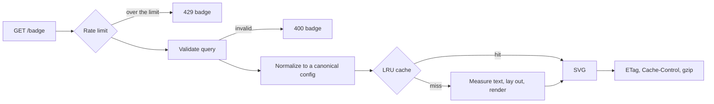

# Plaque

Badges for README files that adapt to the reader's screen.

<p>
  <picture>
    <source media="(max-width: 600px)" srcset="https://plaque-ziwx.onrender.com/badge?label=runtime&amp;value=Bun&amp;color=neutral&amp;icon=bun&amp;theme=auto&amp;layout=vertical">
    
  </picture>
  <picture>
    <source media="(max-width: 600px)" srcset="https://plaque-ziwx.onrender.com/badge?label=framework&amp;value=NestJS&amp;color=neutral&amp;icon=nestjs&amp;theme=auto&amp;layout=vertical">
    
  </picture>
  <picture>
    <source media="(max-width: 600px)" srcset="https://plaque-ziwx.onrender.com/badge?label=language&amp;value=TypeScript&amp;color=info&amp;icon=typescript&amp;theme=auto&amp;layout=vertical">
    
  </picture>
  <picture>
    <source media="(max-width: 600px)" srcset="https://plaque-ziwx.onrender.com/badge?label=hosted+on&amp;value=Render&amp;color=neutral&amp;icon=rocket&amp;theme=auto&amp;layout=vertical">
    
  </picture>
  <picture>
    <source media="(max-width: 600px)" srcset="https://plaque-ziwx.onrender.com/badge?label=license&amp;value=MIT&amp;color=neutral&amp;icon=law&amp;theme=auto&amp;layout=vertical">
    
  </picture>
</p>

Resize the window: on a narrow screen each badge above stacks its icon over
the value. A status such as `passing` collapses to an icon alone instead
(the `compact` layout).

Plaque is a small stateless NestJS service. It is not a shields.io clone: the
point is the layout that changes with the screen width, which a plain ``
cannot do on its own.

Live service: <https://plaque-ziwx.onrender.com> (Swagger UI at `/docs`). It
runs on a free Render instance that sleeps after 15 minutes without traffic,
so the first request after a quiet period can take up to a minute.

## How the adaptation works

An SVG inside `` sees only its own width, not the screen's, and a small
badge in a README is never scaled down. So Plaque renders three separate SVGs
(`full`, `compact`, `vertical`) and the README picks one with
`<picture><source media>`. `GET /snippet` builds that HTML for you.

<!-- prettier-ignore -->
```html
<picture>
  <source media="(max-width: 600px)" srcset="https://YOUR-HOST/badge?label=build&amp;value=passing&amp;color=success&amp;icon=check-circle&amp;theme=auto&amp;layout=compact">
  
</picture>
```

- On a narrow screen the label gives way to an icon.
- A status (`passing`, `failing`, `building`, ...) becomes a status icon in
  `compact`. Data (`12.4k`, `v2.1`) uses `vertical`: icon on top, value below.
  The service decides which one by an exact match against a list of status
  words, so a value like `stable` stays data.
- Browsers that ignore `<picture>` fall back to the `full` image.

## Quick start

With Docker:

```sh
docker build -t plaque .
docker run --rm -p 3000:3000 plaque
```

With Bun:

```sh
bun install
bun run start
```

Then open <http://localhost:3000/badge?label=build&value=passing&icon=check-circle>
or the Swagger UI at <http://localhost:3000/docs>.

## API

### `GET /badge`

Returns an SVG. `value` is required, everything else is optional.

| Param    | Meaning                                                 | Limits                         |
| -------- | ------------------------------------------------------- | ------------------------------ |
| `label`  | Left text. Shown in `full` only.                        | up to 24 chars, may be empty   |
| `value`  | Right text: a status or data.                           | 1 to 24 chars, not blank       |
| `color`  | `success`, `warning`, `error`, `info`, `neutral` or hex | six hex digits **without** `#` |
| `icon`   | Icon name from the whitelist below                      | unknown name is a 400          |
| `theme`  | `auto` (follows the system theme), `light`, `dark`      | default `auto`                 |
| `layout` | `full`, `compact`, `vertical`                           | default `full`                 |

Hex has no `#` because `#` starts a URL fragment.

Icons (38): `alert` `apple` `bitbucket` `bug` `bun` `check` `check-circle`
`clock` `code` `codeberg` `docker` `download` `eye` `git-branch`
`git-pull-request` `github` `gitlab` `heart` `info` `law` `linux` `nestjs`
`npm` `package` `repo` `rocket` `shield-check` `skip` `star` `stop` `swift`
`sync` `tag` `typescript` `workflow` `x` `x-circle`

Icon paths are copied into the repository and embedded in the SVG, so a badge
makes no external requests.

### `GET /snippet`

Takes the same params as `/badge` except `layout`, plus `breakpoint` (screen
width in px, 320 to 1200, default 600). Returns the `<picture>` HTML as
`text/plain`. The origin in the URLs comes from `PUBLIC_URL`, or from the
request host if it is not set.

### Errors are badges too

A broken image in a README is worse than a message, so errors come back as
SVG:

| Status | Badge                   | Notes                                    |
| ------ | ----------------------- | ---------------------------------------- |
| 400    | `error: invalid params` | `Cache-Control: max-age=60`              |
| 429    | `error: rate limited`   | `Retry-After`, `Cache-Control: no-store` |

`GET /health` returns `200` when the service is alive.

## Architecture



A light hexagonal layout. `src/core/` is pure TypeScript with no Nest imports:
config, icons, text measuring, layout, SVG rendering and the cache port. An
oxlint rule (`no-restricted-imports`) keeps Nest out of it. Adapters live
outside: `src/badge/` (HTTP), `src/infra/` (LRU cache, rate limiter),
`src/health/`. Ports exist only where there is a real replacement: the cache
and the text measurer.

## Decisions and trade-offs

- **The server computes the layout.** Text is measured from Inter metrics and
  written with `textLength` and `lengthAdjust="spacingAndGlyphs"`, so a badge
  keeps its width with any system font. Measured width is within 1 to 2% of a
  real render. Too-long text is cut with an ellipsis.
- **An unknown icon is an error.** A typo shows up at once instead of
  producing a silently different badge that would be cached as normal. The
  whitelist is the contract and shows up in Swagger as an enum.
- **Status versus data is an exact word list.** Calling data a status loses
  information on a narrow screen, while the opposite mistake only costs some
  space. Words that are often plain data (`stable`, `active`, `beta`) are not
  in the list.
- **Cache key is the canonical config.** Equivalent requests (`color=success`
  and no color, params in another order) hit the same entry. The ETag is a
  sha256 of the SVG, so clients get a `304` without a body.
- **The rate limiter is my own.** `@nestjs/throttler` took about 70% of
  `/badge` throughput in the first benchmark. The replacement is a fixed
  window per client in a `Map`, no timers, memory capped at 10,000 clients.
  Trade-offs: up to 2x the limit around a window edge, and counters are per
  process.
- **The limit is generous (300 per minute).** GitHub's image proxy makes many
  readers look like a few IPs. Cloudflare caching goes in front.
- **Limits run before routing.** URL up to 2048 chars (414), up to 16 query
  params (400), body up to 1 KB (413).
- **Fixed height.** Proportions come from `viewBox`, so a badge cannot shrink
  below its content. That is why `compact` and `vertical` are separate SVGs.
- **Theme `auto` follows the system theme.** A theme set by hand on GitHub
  that differs from the system one was not checked.

## Performance

Apple M3 Pro, 12 threads, Bun 1.4.3, 64 connections, 10 s per run, client and
server on one machine. Reproduce with `bun run bench`.

Service alone, no HTTP:

| Case                                |  Badges/s |
| ----------------------------------- | --------: |
| no cache, every badge rendered      |   440,327 |
| cache, a different badge every time |   319,885 |
| cache, same badge                   | 5,231,574 |

Over HTTP:

| Scenario                     | Cache | Requests/s | p50, ms | p99, ms |
| ---------------------------- | ----- | ---------: | ------: | ------: |
| same badge                   | off   |     34,946 |       1 |       3 |
| same badge                   | on    |     41,677 |       1 |       2 |
| a different badge every time | off   |     39,283 |       1 |       3 |
| a different badge every time | on    |     37,261 |       1 |       3 |
| client already has it (304)  | off   |     38,058 |       1 |       3 |
| client already has it (304)  | on    |     44,566 |       1 |       2 |

What this says: rendering is already fast (440k badges/s), so over HTTP the
cache adds about 17 to 19% on repeats and costs about 5% when every badge is
new. The first run showed about 4,000 req/s in every scenario, which is how
the rate limiter problem was found.

## Configuration

| Variable               | Default      | Meaning                                        |
| ---------------------- | ------------ | ---------------------------------------------- |
| `PORT`                 | `3000`       | HTTP port                                      |
| `PUBLIC_URL`           | request host | Origin used in `/snippet` output               |
| `TRUST_PROXY`          | `false`      | `true` to use the client IP from proxy headers |
| `RATE_LIMIT_MAX`       | `300`        | Requests per client per window                 |
| `RATE_LIMIT_WINDOW_MS` | `60000`      | Window length                                  |
| `BADGE_CACHE_SIZE`     | `1000`       | Rendered badges kept in memory, `0` disables   |
| `WEB_DIR`              | `dist/web`   | Built web app served at `/`, skipped if absent |

A bad value stops the service at start instead of silently turning a limit
off.

## Development

```sh
bun run start:dev     # watch mode
bun run build         # server and web bundle into dist/
bun run dev:web       # rebuild the web app on change
bun run format        # oxfmt
bun run typecheck     # tsc --noEmit
bun run lint          # oxlint, type-aware
bun run test          # unit tests (bun test)
bun run test:e2e      # HTTP tests
bun run render:check  # screenshots of every layout, light and dark
bun run bench         # benchmark, writes .bench/results.md
```

CI runs everything above except the benchmark, then builds the Docker image and
checks `/health` and `/badge` on it.

Stack: TypeScript 7 (type checking only), NestJS 12 on Fastify, Bun (runtime,
package manager, bundler, tests), Oxc, GitHub Actions.

## Where it renders

- GitHub: `<picture>` keeps `media` on `<source>`. At 592 px the narrow layout
  shows, at 648 px the full one.
- Other platforms (GitLab, Codeberg, Bitbucket): not checked yet.

## License

[MIT](LICENSE). Third-party licenses are listed in the Credits below.

## Credits

Icons from [Octicons](https://primer.style/octicons) (MIT) and
[Simple Icons](https://simpleicons.org) (CC0; trademarks belong to their
owners). Text metrics from [Inter](https://rsms.me/inter/) (OFL-1.1).
Licenses are in [THIRD_PARTY_LICENSES.md](THIRD_PARTY_LICENSES.md).
